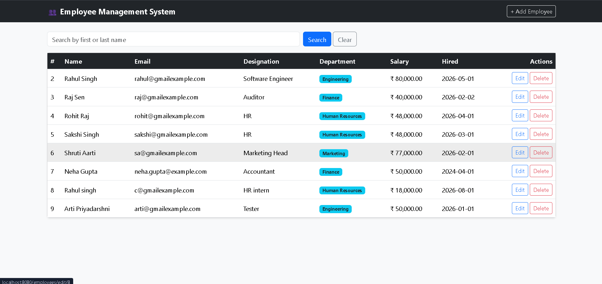
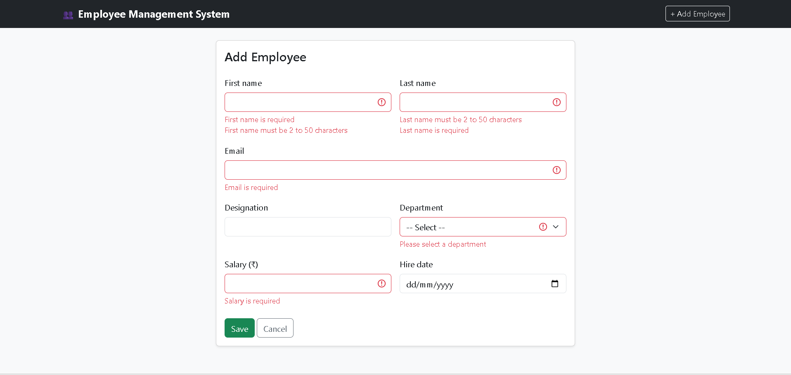
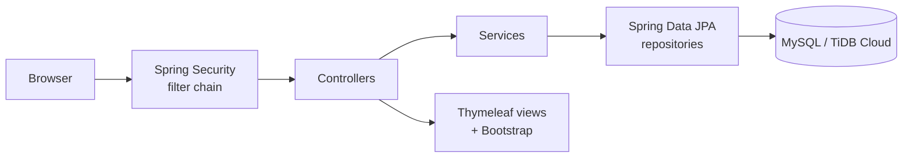
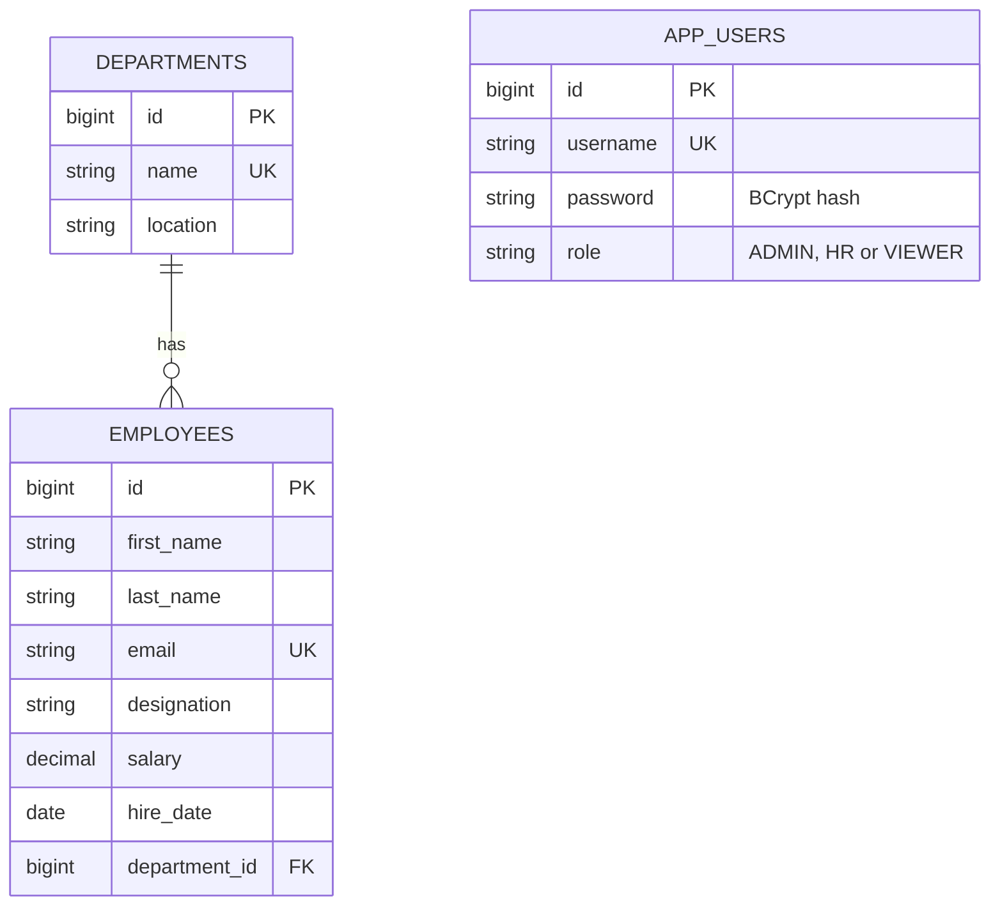

<div align="center">

# Employee Management System

**A secure Spring Boot web app for managing employees and departments, with role-based access for Admin, HR and Viewer users.**

[](https://employee-management-system-yuzi.onrender.com)


</div>

> **Live demo:** https://employee-management-system-yuzi.onrender.com
> Runs on Render's free plan, which sleeps when idle, so the first request can take about a minute. Browse freely, or sign in with a [demo account](#roles-and-permissions) to add, edit or delete.

Built as the Java Full Stack minor project during my internship at **Adyapan**.

## What it does

A server-rendered portal for keeping personnel records: each employee has contact details, a designation, a salary, a hire date and a department. Anyone can browse and search the list; signed-in HR staff can add and edit records, and only an Admin can delete them. Access rules are enforced on the server, not only by hiding buttons.

## Features

- **Employee CRUD** with a many-to-one link to departments
- **Case-insensitive search** by first or last name
- **Spring Security form login** with three roles (Admin, HR, Viewer), BCrypt-hashed passwords and CSRF tokens on every form
- **Role-aware UI**: buttons a role can't use are hidden, and typing the URL directly returns a 403 page
- **Bean Validation** with field-level error messages, plus duplicate-email protection
- **Global exception handler** that renders friendly 400, 404, 409 and 500 pages
- **Tests** for services (JUnit 5 + Mockito), repositories and validation (H2), and access rules for every role (MockMvc + Spring Security Test)
- **Docker deployment** on Render with a MySQL-compatible TiDB Cloud database; the image uses Class Data Sharing to start faster on a small CPU

## Screenshots

| Employee list and search | Add form with validation |
|---|---|
|  |  |

## Roles and permissions

Rules come from [`SecurityConfig`](src/main/java/com/example/employee_management_system/config/SecurityConfig.java).

| Action | Visitor (signed out) | Viewer | HR | Admin |
|---|:---:|:---:|:---:|:---:|
| View and search employees | ✅ | ✅ | ✅ | ✅ |
| Add an employee | | | ✅ | ✅ |
| Edit an employee | | | ✅ | ✅ |
| Delete an employee | | | | ✅ |

Three demo accounts are created on startup, and their passwords are re-synced from configuration on every start:

| Username | Demo password | Role |
|---|---|---|
| `admin` | `admin123` | ADMIN |
| `hr` | `hr123` | HR |
| `viewer` | `viewer123` | VIEWER |

These are public demo defaults. Override them with `ADMIN_PASSWORD`, `HR_PASSWORD` and `VIEWER_PASSWORD`, and set `SHOW_DEMO_LOGINS=false` to hide the demo box on the login page.

## Architecture





Hibernate creates the tables on first run (`ddl-auto=update`). Four sample departments (Engineering, Human Resources, Finance, Marketing) are inserted when the table is empty.

## Routes

| Method | URL | Purpose | Access |
|---|---|---|---|
| GET | `/` | Redirects to `/employees` | Everyone |
| GET, POST | `/login` | Sign-in page / submit credentials | Everyone |
| POST | `/logout` | Sign out | Signed in |
| GET | `/employees?keyword=` | List employees, optional name search | Everyone |
| GET | `/employees/new` | Add form | Admin, HR |
| GET | `/employees/edit/{id}` | Edit form | Admin, HR |
| POST | `/employees/save` | Create or update | Admin, HR |
| POST | `/employees/delete/{id}` | Delete | Admin |

Form fields, validation rules and error responses are documented in [docs/API.md](docs/API.md).

## Getting started

### Configuration

| Variable | Default | Purpose |
|---|---|---|
| `DB_URL` | `jdbc:mysql://localhost:3306/ems_db` | JDBC URL |
| `DB_USER` | `root` | Database user |
| `DB_PASSWORD` | *(empty)* | Database password |
| `PORT` | `8080` | HTTP port (Render sets this) |
| `ADMIN_PASSWORD`, `HR_PASSWORD`, `VIEWER_PASSWORD` | demo values | Sign-in passwords |
| `SHOW_DEMO_LOGINS` | `true` | Show demo accounts on the login page |

For local runs you can instead put `spring.datasource.password=...` in a `local.properties` file next to `pom.xml`; it is git-ignored and loaded automatically.

### Run locally

Requires JDK 17+ and a running MySQL 8 server. Maven is not needed; the wrapper is included.

```bash
git clone https://github.com/Rahul-web01/Employee-Management-System.git
cd Employee-Management-System
mysql -u root -p -e "CREATE DATABASE IF NOT EXISTS ems_db;"
DB_PASSWORD=your_mysql_password ./mvnw spring-boot:run
```

On Windows PowerShell:

```powershell
$env:DB_PASSWORD="your_mysql_password"; .\mvnw.cmd spring-boot:run
```

Open http://localhost:8080.

### Run with Docker

```bash
docker build -t employee-management-system .
docker run --rm -p 8080:8080 \
  --add-host=host.docker.internal:host-gateway \
  -e DB_URL="jdbc:mysql://host.docker.internal:3306/ems_db" \
  -e DB_USER=root \
  -e DB_PASSWORD=your_mysql_password \
  employee-management-system
```

This connects the container to MySQL running on your machine. Point `DB_URL` at any other MySQL-compatible database (for example TiDB Cloud) the same way.

### Run tests

Tests use an in-memory H2 database, so MySQL is not required.

```bash
./mvnw test
```

## Deployment

The live demo runs this Dockerfile as a Render web service, backed by a free TiDB Cloud cluster. Set `DB_URL`, `DB_USER` and `DB_PASSWORD` in Render (TiDB needs TLS parameters in the JDBC URL, such as `sslMode=VERIFY_IDENTITY`), plus `SPRING_DATASOURCE_HIKARI_MAX_LIFETIME=300000` so pooled connections are recycled before TiDB closes idle ones.

## Tech stack

| Layer | Technology |
|---|---|
| Language | Java 17 |
| Framework | Spring Boot 4.1 (Spring MVC) |
| Security | Spring Security 7: form login, roles, BCrypt, CSRF |
| Persistence | Spring Data JPA, Hibernate |
| Database | MySQL 8 locally, TiDB Cloud in production, H2 for tests |
| UI | Thymeleaf + Spring Security extras, Bootstrap 5.3 |
| Testing | JUnit 5, Mockito, MockMvc, Spring Security Test |
| Build and deploy | Maven wrapper, multi-stage Docker image, Render |

## Project structure

```
src/main/java/com/example/employee_management_system
├── config        SecurityConfig, DataLoader (sample departments), UserSeeder (demo accounts)
├── controller    Employee, auth and home controllers
├── entity        Employee, Department, AppUser, Role
├── exception     Custom exceptions and GlobalExceptionHandler
├── repository    Spring Data JPA repositories
├── security      UserDetailsService backed by the database
└── service       Business logic
src/main/resources/templates   Thymeleaf pages (login, employees, error, fragments)
src/test/java                  Service, repository, validation and security tests
docs/                          Route documentation and screenshots
```

## Roadmap

- Pagination and sorting for the employee list
- Department management pages
- REST API with OpenAPI / Swagger docs
- Dashboard with charts
- Flyway database migrations
- GitHub Actions CI

## Author

**Rahul Singh**, B.Tech Computer Science and Engineering student, Lucknow, India

[](https://github.com/Rahul-web01)
[](https://www.linkedin.com/in/rahul-singh-cs)

---

<div align="center">

If you found this useful, consider giving it a ⭐

</div>
