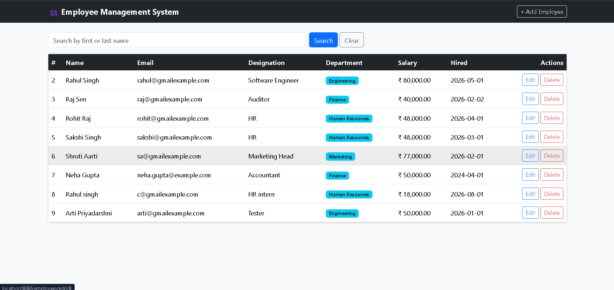
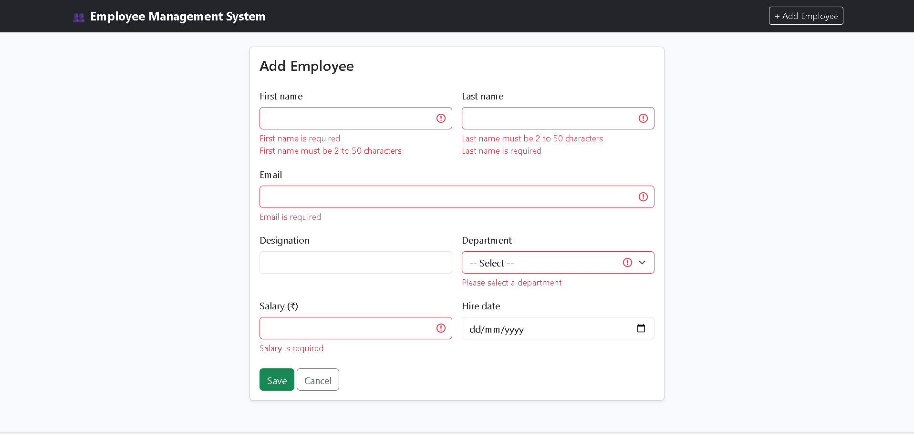

<div align="center">

# 👥 Employee Management System

**A full-stack CRUD web app to manage employees, departments, and salary records**


*Java Full Stack minor project, built during my internship at **Adyapan** 🚀*

</div>

---

## 📖 About

Small and medium organizations need a simple, secure portal to track personnel records, department assignments, and salary details. This project is a **server-side rendered web application** that does exactly that, using a clean layered architecture (Controller → Service → Repository → Database).

---

## ✨ Features

| Status | Feature |
|:---:|---|
| ✅ | Full CRUD for employees: create, view, update, delete |
| ✅ | Many-to-one relationship: each employee belongs to a department |
| ✅ | Search employees by first or last name (case-insensitive) |
| ✅ | Responsive Thymeleaf pages styled with Bootstrap |
| ✅ | Form validation with field-level error messages (`@NotBlank`, `@Email`, `@Size`, and more) |
| ✅ | Duplicate email protection |
| ✅ | Global exception handler with friendly 400, 404, 409, and 500 pages |
| ✅ | Unit tests (JUnit 5 + Mockito) and repository tests (H2) |

---

## 🛠️ Tech Stack

| Layer | Technology |
|---|---|
| **Language** | Java 17 |
| **Framework** | Spring Boot |
| **Persistence** | Spring Data JPA, Hibernate |
| **Database** | MySQL 8 (H2 for tests) |
| **UI** | Thymeleaf, Bootstrap 5 |
| **Validation** | Jakarta Bean Validation |
| **Testing** | JUnit 5, Mockito |
| **Build tool** | Maven (wrapper included) |

---

## 🏗️ Architecture

```
   Browser
      │
      ▼
┌─────────────┐   ┌─────────────┐   ┌──────────────┐   ┌─────────┐
│ Controller  │ → │   Service   │ → │  Repository  │ → │  MySQL  │
│ (web layer) │   │ (business)  │   │ (Spring JPA) │   │   DB    │
└─────────────┘   └─────────────┘   └──────────────┘   └─────────┘
      │
      ▼
 Thymeleaf templates (HTML)
```

---

## 🗂️ Project Structure

```
src/main/java/com/example/employee_management_system
├── config         # DataLoader (sample departments on first run)
├── controller     # Handles web requests
├── service        # Business logic
├── repository     # Database access (Spring Data JPA)
├── entity         # JPA entities (Department, Employee)
└── exception      # Custom exceptions + global handler

src/main/resources
├── templates      # Thymeleaf pages (employees/, error/, fragments)
└── application.properties

src/test/java/...  # Service, repository, and validation tests
```

---

## 🗄️ Database Design

```
┌──────────────────┐            ┌──────────────────────┐
│   departments    │            │      employees       │
├──────────────────┤            ├──────────────────────┤
│ id (PK)          │◄───────────│ department_id (FK)   │
│ name (unique)    │  1      *  │ id (PK)              │
│ location         │            │ first_name           │
└──────────────────┘            │ last_name            │
                                │ email (unique)       │
                                │ designation          │
                                │ salary               │
                                │ hire_date            │
                                └──────────────────────┘
```

Hibernate creates the tables automatically on the first run. Four sample departments (Engineering, Human Resources, Finance, Marketing) are added if the table is empty.

---

## 🌐 Routes

| Method | URL | Purpose |
|---|---|---|
| GET | `/employees` | List employees (optional `?keyword=`) |
| GET | `/employees/new` | Show the add form |
| GET | `/employees/edit/{id}` | Show the edit form |
| POST | `/employees/save` | Create or update an employee |
| POST | `/employees/delete/{id}` | Delete an employee |

Full details, form fields, validation rules, and error responses are in [docs/API.md](docs/API.md).

---

## 🚀 Getting Started

### Prerequisites

- ☕ JDK 17 or higher
- 🐬 MySQL 8 (server running)
- 🔧 Git

> You do **not** need to install Maven. The Maven Wrapper is included.

### 1️⃣ Clone the repository

```bash
git clone https://github.com/Rahul-web01/Employee-Management-System.git
cd Employee-Management-System
```

### 2️⃣ Create the database

Run in MySQL Workbench or the MySQL command line:

```sql
CREATE DATABASE IF NOT EXISTS ems_db;
```

### 3️⃣ Set your database password

Create a file named `local.properties` in the project root (next to `pom.xml`) with one line:

```properties
spring.datasource.password=YOUR_PASSWORD
```

> 🔒 `local.properties` is in `.gitignore`, so your password is never pushed to GitHub.

The app connects to `jdbc:mysql://localhost:3306/ems_db` as user `root` by default. You can override this with the environment variables `DB_URL`, `DB_USER`, and `DB_PASSWORD`.

### 4️⃣ Run the application

**Windows (PowerShell):**

```powershell
.\mvnw.cmd spring-boot:run
```

**Mac / Linux:**

```bash
./mvnw spring-boot:run
```

Then open 👉 **http://localhost:8080**

---

## 🧪 Running Tests

Tests use an in-memory H2 database, so MySQL is not needed.

```bash
./mvnw test
```

On Windows PowerShell: `.\mvnw.cmd test`

---

## 📸 Screenshots

### Employee list and search


### Add employee form with validation


---

## 🗺️ Roadmap

- [ ] Pagination for the employee list
- [ ] Department management pages
- [ ] Role-based login with Spring Security
- [ ] Live demo deployment (

🔗 **Live Demo:** https://employee-management-system-yuzi.onrender.com
> Hosted on a free server that sleeps when idle, so the first load can take about a minute.)

---

## 👨‍💻 Author

**Rahul Singh**
B.Tech Computer Science and Engineering student, Lucknow, India

[](https://github.com/Rahul-web01)

---

<div align="center">

⭐ If you like this project, give it a star!

</div>
